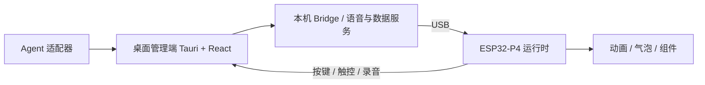

  
  <h1>HachimoDock（哈基米机）</h1>
  
<strong>面向 AI Agent 的桌面交互终端</strong>

  

    通过 Windows/macOS 管理端与 ESP32-P4 设备，呈现任务状态、语音输入与互动组件。
  

  

    
  

  

    <a href="#硬件方案">硬件方案</a>
    · <a href="#硬件端资料">硬件端资料</a>
    · <a href="#图集">图集</a>
    · <a href="#软件架构">软件架构</a>
    · <a href="#复刻与部署">复刻与部署</a>
    · <a href="#快速开始">快速开始</a>
    · <a href="#常见问题">常见问题</a>
  

  

    
    
    
  

  

    
    
  

## 项目简介

HachimoDock（哈基米机）是面向 AI Agent 的桌面交互终端，由 Windows/macOS 管理端与 ESP32-P4 设备组成，提供工作状态显示、语音输入、自定义形象和互动组件。桌面应用的安装名称为 **HachimiDock**，部分开发文档使用 **Pet Manager** 指代管理端。

[English](README.en.md) · [下载最新版本](https://github.com/YizhengWw/HachimoDock/releases/latest) · [问题反馈](https://github.com/YizhengWw/HachimoDock/issues) · [安全反馈](SECURITY.md)

## 当前版本与下载

| 项目 | 版本 / 平台 | 获取方式 |
| --- | --- | --- |
| 桌面安装包 | **0.1.199**；macOS Apple silicon / Windows x64 | [Release 附件](https://github.com/YizhengWw/HachimoDock/releases/tag/v0.1.199) |
| 配套设备固件 | **0.7.103-p4-r179**；ESP32-P4 v1 / v3 分别提供 | 同一 Release 的完整烧录包；日常升级使用客户端 |
| 当前源码 | 客户端版本 0.1.199 / 固件版本 R179，可能包含发布后的修正 | `main`；[PC 构建](pc/README.md)、[固件构建](firmware/BUILD.md) |

[下载 Mac 0.1.199（Apple silicon）](https://github.com/YizhengWw/HachimoDock/releases/download/v0.1.199/HachimiDock_0.1.199_macOS-arm64.dmg) · [下载 Windows 0.1.199（x64）](https://github.com/YizhengWw/HachimoDock/releases/download/v0.1.199/HachimiDock_0.1.199_Windows-x64-setup.exe)

完整烧录包的文件名标注 v1/v3，按实际芯片选择，不能互刷。0.1.199 仅更新客户端，继续使用 R179 固件；已安装 R179 的设备无需重复升级。桌面安装包、配套固件及源码归档的版本对应关系见该 Release 的更新说明。

当前预编译桌面包覆盖 Apple silicon Mac 和 Windows x64；不提供 Intel Mac 或 Linux 安装包。macOS 包已使用 Developer ID 签名并通过 Apple 公证，Windows 安装器未做发行者签名。下载后先按 `SHA256SUMS` 核对完整性；不要关闭系统安全检查来运行来源不明的副本。

## 核心能力

| 能力 | 说明 |
| --- | --- |
| Agent 状态跟随 | 将活动会话的思考、执行、等待、完成和错误状态呈现在设备动画与任务气泡中。事件完整程度取决于 Agent 适配器。 |
| 语音输入 | 按住语音键录音，松开后识别并追加到目标输入框；确认后才发送。灰色提示文字不属于草稿。 |
| 实时对话 | 在宠物页面长按 SW2 开始或结束；使用用户配置的识别、对话和语音服务。 |
| 形象与音效 | 内置西高地形象，支持导入或生成自定义外观、状态视频和提示音；兼容固件支持独立下发音效。 |
| 组件中心 | 预览、安装和移除游戏、工具及 PC 数据组件；通过 `petui` Skill 创作声明式有界组件。 |
| 音量与城市 | 首页语音输入模块下方统一调整设备总音量、自动识别城市或搜索并保存手动城市/区县。 |
| 按键配置 | 配置三个按键与摇杆的操作，组件退出遵循设备全局返回设置。 |
| USB 协同 | 桌面端负责状态、数据、素材与升级传输；连接状态和回执未知时不会自动重放变更。 |

公开发行版不提供服务 Key。需要语音、对话或内容生成能力时，请在客户端“API 配置”中填写自己的凭据。城市定位可关闭；自动模式通过出口 IP 估算城市，不能代替 GPS。详见[音量与共享城市](pc/docs/shared-device-settings.md)。

### Agent 兼容范围

当前适配 ChatGPT（Codex）、Claude、OpenClaw、MiMoCode、WorkBuddy 和 DeepSeek Harness。**状态跟随、语音草稿、确认发送与桌面对话切换是不同能力**；检测到程序不代表其输入框已可用。

- ChatGPT（Codex）、Claude、WorkBuddy、DeepSeek Harness 的桌面语音输入依赖当前可用的系统辅助功能输入框。
- WorkBuddy 与 DeepSeek 的目标对话需在对应应用中打开；设备气泡选择不会自动切换它们的桌面对话。
- MiMoCode 的语音支持与平台相关；OpenClaw 使用其会话路由。具体限制见 [Agent 接入与兼容说明](pc/docs/agent-integration-audit.md)。
- 目标不明确、输入框不可用或提交结果未知时，本次操作会停止；不会选取最近的历史会话或自动重复发送。

### 组件与资源

设备运行声明式组件及受限运行时原语，不是通用浏览器或任意脚本环境。新能力以设备实际声明和对应契约为准；开发配置、离线测试和编译通过不能代替实机兼容与性能验证。

组件通过 PC 同步。缺少可选触控能力不阻止安装，但触控玩法可能无法使用；包格式、资源完整性和存储上限仍需满足。音乐、电台、天气等 PC 数据功能需要管理端保持运行，部分内容需要联网。用户上传内容的权利由相应权利人保留。

1. 在支持的 Agent 中使用 `petui` Skill 描述游戏或工具。
2. 按设备逻辑画布、输入与资源配额生成组件，通过结构和资源校验。
3. 在组件中心预览，选择“同步到设备”；不用的组件可从设备移除。

开发契约见 [PetUI Skill](pc/skills/petui/SKILL.md)，实时数据见 [数据组件](pc/docs/widget-live-data.md)、[电脑状态与近期待办](pc/docs/local-live-widgets.md)。

### 状态跟随演示

## 快速开始

1. 下载并安装适合电脑系统的客户端，将设备通过数据线连接电脑。
2. 在设备首页确认设备连接与固件版本；已有设备优先使用“固件升级”。
3. 选择跟随的 Agent、形象和按键配置。需要语音输入时，授权客户端的系统辅助功能，并打开目标对话。
4. 配置所需语音与对话服务；按住 SW1 说话，松开后查看草稿，短按确认键发送。

| 默认操作 | 行为 |
| --- | --- |
| SW1 短按 / 摇杆中键 | 确认或进入 |
| 按住 SW1、松开 | 录音、结束并写入语音草稿 |
| SW2 短按 | 切换宠物页面与组件中心；组件可绑定自己的动作 |
| SW2 长按 | 开始或结束实时对话 |
| SW3 短按 | 返回或取消 |
| 摇杆方向 | 选择会话、组件或执行组件映射动作 |

这些是出厂默认值，用户配置优先。语音确认发送不等于批准 Agent 的工具权限请求。WorkBuddy 的操作边界见[专门说明](pc/docs/workbuddy.md)。

macOS 安装受阻时，先检查下载来源和校验值，再按系统“隐私与安全性”的提示处理。不要对未知应用解除隔离或关闭 Gatekeeper。语音输入所需权限位于“系统设置 → 隐私与安全性 → 辅助功能”。

### 新设备或恢复出厂

Release 提供 v1、v3 两种完整烧录包，均包含 Bootloader、应用固件、形象、组件及双平台烧录工具。请按实际芯片修订版选择，不能互刷；微雪 ESP32-P4-WIFI6-M 的 M 不代表芯片版本。同一芯片的固件由 Windows/macOS 共用。完整镜像会覆盖设备现有数据。

**v1 与 v3 烧录包不可互刷，具体版本可以咨询客服进行确认。** 包内脚本需要 Python 3.10+，自动安装 esptool **5.4.0**。屏幕连接 **DSI**，不是 CSI；请断电后插拔排线。详细版本和步骤见 [固件构建与烧录指南](firmware/BUILD.md)。

v3 的 24 MHz 显示修复已在实机确认恢复宠物动画；本版本按键、麦克风、完整形象与固件传输等仍需实机验收，请先在测试设备上验证。

## 图集

<table>
  <tr>
    <td width="50%">
      
       
      桌面小屏实拍：把 Agent 状态放到工位视野里。
    </td>
    <td width="50%">
      
       
      新版三按键与四向摇杆机身，屏幕显示内置西高地形象。
    </td>
  </tr>
</table>

家居控制能力由[**Xiaomi MiLoCo**](https://github.com/XiaoMi/xiaomi-miloco) 提供，相关 MiLoCo 授权作品的版权归小米所有，适用 [Xiaomi Miloco License](https://github.com/YizhengWw/HachimoDock/blob/main/licenses/Xiaomi-Miloco-LICENSE.md)，版权标识、免责声明及许可证随相关实现一并保留。非商业使用仍须符合该许可证的用途范围；本项目不向第三方授予额外的商业使用、再许可或商标权限。完整说明见 [第三方声明](https://github.com/YizhengWw/HachimoDock/blob/main/THIRD_PARTY_NOTICES.md)。

## 硬件方案

本仓库给出软件和固件配套；PCB、BOM、硬件装配和复刻资料请看：
[OSHWHub 硬件端页面](https://oshwhub.com/eda_gqvzlprk/project_cnbmkbjc#3-%E7%A1%AC%E4%BB%B6%E5%A4%8D%E5%88%BB)。

| 模块 | 当前方案 |
|---|---|
| 主控 | ESP32-P4，RISC-V 双核，HP 最高 400MHz |
| 存储 | 32MB Flash，32MB PSRAM |
| 屏幕 | 2.8 英寸 MIPI-DSI；物理面板 480×640，应用逻辑画布 640×480，经旋转输出 |
| 输入 | 3 个实体按键、四向中按摇杆及配套触控屏；按键可配置 |
| 音频 | 板载麦克风语音采集，桌面端 ASR 与 Agent 输入路由 |
| 连接 | USB-UART 用于烧录、日志和日常数据传输；硬件保留原生 USB HS OTG 能力 |
| 扩展 | PetUI 通用小组件/小游戏运行时，组件通过桌面端同步到设备 |

## 硬件端资料

硬件端不只是一张接线图，包含从主控、屏幕、PCB、外壳到装配的复刻路径：

| 内容 | 入口 |
|---|---|
| 硬件复刻总入口 | [OSHWHub 项目页](https://oshwhub.com/eda_gqvzlprk/project_cnbmkbjc#3-%E7%A1%AC%E4%BB%B6%E5%A4%8D%E5%88%BB) |
| 桌面客户端与完整固件 | [GitHub Releases](https://github.com/YizhengWw/HachimoDock/releases/latest) |
| 完整性校验 | 当前 Release 提供 `SHA256SUMS`；烧录清单位于完整烧录包内 |

## 软件架构与开发

| 目录 | 内容 | 开发入口 |
| --- | --- | --- |
| `pc/` | 桌面 UI、本机适配器、组件 Skill 与资源 | [PC 构建](pc/README.md) |
| `firmware/` | 板级驱动、渲染、输入、协议及出厂镜像工具 | [固件构建](firmware/BUILD.md)、[协议](firmware/protocol.md) |
| `integrations/` | Agent 集成与相关契约 | [DSH 集成](integrations/dsh-hachimodock/README.md) |

资源保存在普通 Git 中，克隆不依赖 Git LFS。构建以锁定依赖和目标平台配置为准；不同发布包的源码对应关系以各 Release 说明为准。源码实现、离线验证、硬件测试和声学验证应分别评估，不作所有设备均已验收的承诺。

新机的 32 MiB Flash 使用双 OTA 各 3 MiB、组件与元数据 8.875 MiB、内置及自定义形象各 8.5 MiB。普通 OTA 不会改变旧设备分区；迁移分区需要完整烧录，会清除设备数据。

## 常见问题

**物理屏幕与组件画布为什么尺寸不同？** 物理面板为 480×640，组件使用 640×480 横向逻辑坐标，由固件旋转输出。更换屏幕需同时核对接口、初始化和触控坐标，不能只看驱动芯片名称。

**缺少触控还能安装组件吗？** 可以安装；依赖触控的玩法可能不可用。实体按键、摇杆和语音有各自的输入路径。

**设备一定要联网吗？** 设备状态、形象和组件同步走 USB，不要求 ESP32-P4 加入局域网。语音识别、Agent 本身以及 AI 形象或组件生成仍可能需要电脑联网。

**如何反馈？** 使用 [GitHub Issues](https://github.com/YizhengWw/HachimoDock/issues)，附客户端/固件版本、系统和复现步骤。不要公开 Key、完整用户日志、对话正文或设备/个人标识。安全问题请按 [SECURITY.md](SECURITY.md) 私下反馈。

## 下载完整性

当前 Release 的 `SHA256SUMS` 对照实际附件；完整烧录包内部另含镜像和分段校验清单。下载后核对 SHA-256，避免混用不同版本、芯片的镜像及清单。校验值能检查文件一致性，不替代来源与签名核验。

## 致谢 / Acknowledgements

感谢以下项目与社区提供的代码、工具及基础能力：

- **[Xiaomi MiLoCo](https://github.com/XiaoMi/xiaomi-miloco)、[MiSans](https://hyperos.mi.com/font/zh/)**：智能家居协议适配参考与设备显示字体。
- **Espressif、Waveshare**：设备开发框架、板级驱动与语音处理能力。
- **Tauri、React、Node.js、FFmpeg、Lucide**：桌面应用、音视频处理及界面基础。
- **[Clawd on Desk](https://github.com/rullerzhou-afk/clawd-on-desk)**：部分 Agent 状态监控与 Hook 桥接代码。

同时感谢参与开发、测试、反馈和组件创作的贡献者。第三方版权与许可详见 [第三方声明](THIRD_PARTY_NOTICES.md)。

## 作者 / Author

贡献者 / Contributors：Wanzheng Liu、Zinuo Tian。

- 📧 邮箱：avalon.ty@gmail.com
- 💬 微信交流群：扫描下方二维码加入

<table>
  <tr>
    <th>微信群二维码</th>
    <th>微信好友二维码（群满备用）</th>
  </tr>
  <tr>
    <td align="center"></td>
    <td align="center"></td>
  </tr>
</table>

微信群已经满了或无法直接加入时，可以先扫描右侧二维码添加微信好友，备注 **“HachimiDock”**，再由管理员邀请你入群。

如果 HachimoDock 对你有帮助，欢迎给仓库点一个 ⭐ **Star**、点击 **Follow** 关注后续更新，也欢迎通过 Issue 提交可复现的问题与建议。

## License

Copyright (C) 2026 Yizheng Wang.

项目采用 [HachimoDock 项目许可证](LICENSE)。允许许可范围内的个人非商业使用、修改和组件创作；商业用途须另行取得书面授权。项目名称、标识及素材的相关权利仍由各权利人保留。

**重要声明：本项目仅限许可范围内的非商业用途。未经权利人书面授权，不得用于商业产品、收费服务或独立于本项目的 APP、Web 服务及其他软件、硬件产品。** 项目内非商业组件开发按许可证明确允许。

Current sources are provided under the [HachimoDock Project License](LICENSE) for permitted non-commercial purposes only. Commercial use and independent product development require prior written permission. Third-party licenses and licenses accompanying earlier releases remain applicable. See the [English overview](README.en.md).
